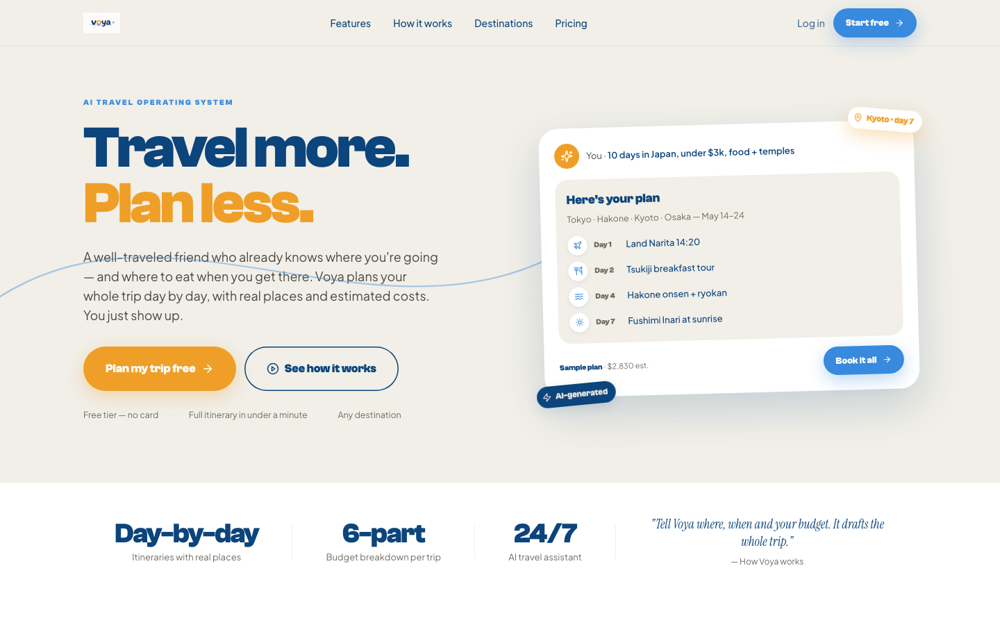
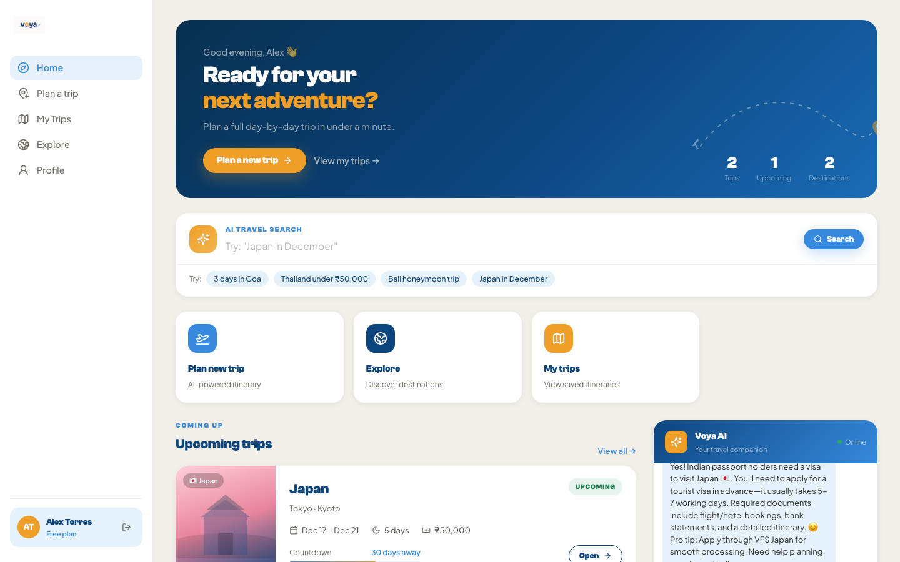
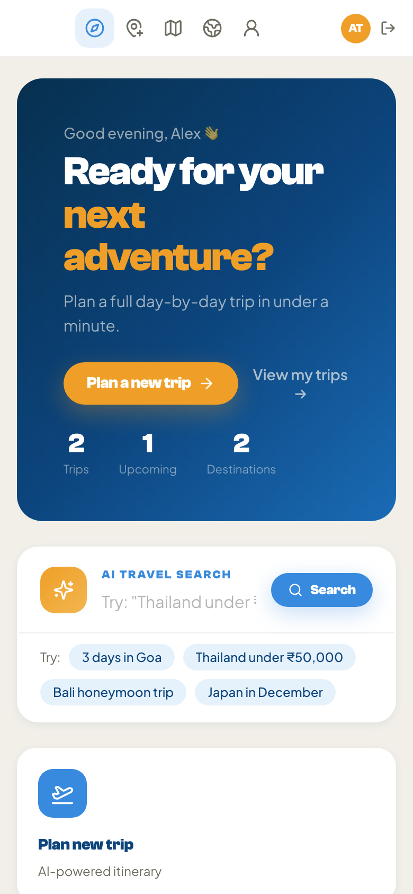

# Voya: AI travel planner

Voya turns a destination, dates and a budget into a day-by-day itinerary with real places and an estimated cost breakdown. You can save trips, track them from wishlist to completed, and ask an AI travel assistant anything.

**Live:** https://voya-travel-website-eta.vercel.app

## Screenshots

| Landing page | Dashboard |
|---|---|
|  |  |
| **AI-generated itinerary** | **My Trips** |
|  |  |

<p align="center"></p>

_The itinerary and dashboard screenshots show real AI output from the live site._

## Features

- **AI itineraries:** day-by-day plans with real hotels, restaurants and landmarks, plus an estimated budget breakdown (flights, stay, food, activities, transport, misc).
- **Personalised:** your home airport, budget tier and travel style from your profile shape every plan.
- **My Trips:** save to wishlist, mark as upcoming ("Book it all") or completed, delete, reopen any itinerary.
- **AI travel agent:** on the dashboard, ask in plain language ("Plan a five-day trip to Bali under ₹60,000, I like beaches and cafes"). You watch it pick and run tools live: places search, real weather forecast, itinerary, budget. Then you change the plan in conversation ("make day two less hectic") and save it with one click.
- **Memory:** Voya remembers lasting preferences you mention (interests, pace, diet…) and your past trips, and uses them next time. You can view, edit or delete them on your Profile.
- **Honest data:** places verified against OpenStreetMap are marked as verified, weather comes only from a real forecast, and budget totals are calculated in code. Anything the AI estimated is labelled as an estimate.
- **Accounts:** email + password, or a passwordless sign-in link sent by email. Google sign-in is planned.
- **Profile:** photo upload, plus stats and achievements computed from your real trips.
- Works on desktop and mobile.

## Tech stack

| Layer | Tech |
|---|---|
| Frontend | HTML/CSS + React 18 (CDN) + Babel Standalone (no build step), Lucide icons |
| Backend | Python, Flask 3, PyJWT |
| Data / Auth / Storage | Supabase (Postgres, Auth, Storage) |
| AI | OpenRouter → free NVIDIA Nemotron 3 Ultra, with automatic fallback to a second free model (configurable) |
| Hosting | Vercel (Python Function, Fluid Compute) |

## Architecture

```
Browser ──► Flask on Vercel ──┬──► Supabase (Postgres · Auth · Storage)
            • pages: / /login /app/*      └──► OpenRouter (AI)
            • JSON API: /api/*
```

- One origin serves both the pages and the API, so all frontend calls are relative (`/api/...`).
- After login (any method) the server issues a signed session token (HS256, 7 days). Every user-scoped endpoint takes the user's email **only** from that token.
- The backend uses the Supabase **service-role** key. Tables have RLS enabled with no public policies, so the public key can't read them.

More detail: [`VOYA_STUDY_GUIDE.md`](VOYA_STUDY_GUIDE.md).

### AI travel agent (LangGraph)

```
load_context → understand → decide ─┬─ (clarify / answer) ─────────┐
 (Supabase)   (LLM: intent   (code   └─ execute_tools → respond ───┴→ persist
               + tool plan)   guardrails)  places · weather ·   (templates for plans,   (messages, draft,
                                           itinerary · budget · LLM only for Q&A)      tool metadata)
                                           save
```

- **Plan-and-execute, single agent.** One LLM call returns the intent, trip details and the tools to run; code then enforces the rules (no save unless the traveller asked in that message, no edits without a draft, dates in range, ask instead of guessing). A full trip plan costs 2 LLM calls, which matters on OpenRouter's free tier (50 requests/day).
- **Grounded tools.** Places and place verification come from Geoapify (OpenStreetMap), weather from Open-Meteo (never estimated outside the 16-day forecast window), and budget totals from Python `Decimal` maths. The LLM only drafts the plan and per-category cost estimates.
- **Memory in the database.** Preferences, conversation history and the draft itinerary live in Supabase and are reloaded on every turn, because serverless instances share nothing between requests.
- **Human in the loop.** New or changed plans come back with a `pending_action`. Saving happens only via `POST /api/agent/confirm` or an explicit "save it", and success is only reported after the row is read back.
- **Endpoints.** `POST /api/agent/chat` (JSON), `POST /api/agent/stream` (Server-Sent Events: `conversation` → `step`… → `result`), `POST /api/agent/confirm`.
- **Evaluation.** `python eval/run_agent_eval.py [--full 3]` scores intent and tool-selection accuracy, parameter extraction, clarification behaviour and latency on 20 realistic requests with the real LLM.

## Project layout

```
backend/app.py          Flask app: page routes + /api
backend/services/       memory.py (preferences + conversation history), ai.py (OpenRouter client), trips.py (save trip)
backend/agent/          LangGraph travel agent: state, prompts, nodes (guardrails), graph, service
backend/tools/          Agent tools: places, weather, budget, itinerary (generate/modify), geo verification
eval/                   Agent evaluation set + runner (real LLM)
e2e/                    Playwright browser tests + local test server
tests/                  pytest suite (unit + integration against Supabase)
frontend/landing/       Landing page          → /
frontend/auth/          Login/signup + OAuth  → /login, /auth/callback
frontend/app/           Signed-in app (JSX)   → /app, /app/plan, /app/trips, /app/explore, /app/profile
frontend/shared/        CSS, logos, voya.js (session + API helper)
supabase/schema.sql     Tables, indexes, RLS, grants, avatars bucket
supabase/migrations/    Incremental migrations, run in order after schema.sql
pyproject.toml          Dependencies + Vercel entrypoint + pytest config
vercel.json             Flask framework, 120s max duration, daily keep-alive cron
```

## Run locally

Requirements: Python 3.12+, a Supabase project, an OpenRouter API key.

```bash
git clone https://github.com/afreenanz/Voya-TravelWebsite.git
cd Voya-TravelWebsite

python3 -m venv .venv
source .venv/bin/activate
pip install -r backend/requirements.txt

cp .env.example .env      # then fill in the values (see below)
python backend/app.py     # → http://localhost:5001
```

> Port 5001 is the default because macOS uses 5000 for AirPlay. Override with `PORT=…`.

### Environment variables

| Variable | Where to get it |
|---|---|
| `SUPABASE_URL` | Supabase → Project Settings → Data API → Project URL |
| `SUPABASE_SERVICE_ROLE_KEY` | Supabase → Project Settings → API Keys → **secret** key (server-side only) |
| `OPENROUTER_API_KEY` | https://openrouter.ai/keys |
| `OPENROUTER_MODEL` | Optional. Model for itineraries; defaults to `nvidia/nemotron-3-ultra-550b-a55b:free` |
| `OPENROUTER_CHAT_MODEL` | Optional. Faster model tried first for chat; defaults to `nvidia/nemotron-3.5-super-vl:free` |
| `OPENROUTER_FALLBACK_MODELS` | Optional, comma-separated backups used when the main model is rate-limited (default `google/gemma-4-31b-it:free`) |
| `GEOAPIFY_API_KEY` | https://myprojects.geoapify.com (free tier). Places search + place verification for the agent tools |
| `APP_SECRET_KEY` | `python3 -c "import secrets; print(secrets.token_urlsafe(48))"` |
| `APP_BASE_URL` | `http://localhost:5001` locally, your production URL on Vercel |

### Database

Run [`supabase/schema.sql`](supabase/schema.sql) in **Supabase → SQL Editor**. It's idempotent and creates the `users`, `trips` and `searches` tables, indexes, RLS, grants and the public `avatars` storage bucket.

Then run each file in [`supabase/migrations/`](supabase/migrations/) in order. `001_agent_memory.sql` adds `user_preferences`, `conversations` and `conversation_messages` (foreign keys to `users.id` with cascade delete, RLS, no public access).

### Tests

```bash
pip install -r requirements-dev.txt
python -m pytest            # unit tests + integration tests against the Supabase project in .env
python -m pytest -m "not integration"   # unit tests only, no network
python -m pytest -m live                # real Geoapify + Open-Meteo calls (no AI)
```

Browser end-to-end tests (Playwright) run the real app against your Supabase project, with real Geoapify and Open-Meteo calls; only the LLM is replaced by a rule-based stand-in:

```bash
cd e2e && npm install && npx playwright install chromium && cd ..
python e2e/fake_agent_server.py &                                   # http://127.0.0.1:5002
node e2e/agent_ui.e2e.js http://127.0.0.1:5002 /tmp/shots          # agent flow, desktop (21 checks)
node e2e/agent_ui.e2e.js http://127.0.0.1:5002 /tmp/shots mobile   # same at 390px
node e2e/site_smoke.e2e.js http://127.0.0.1:5002 /tmp/shots        # every page: console errors, overflow, links
```

Tests never call the AI: OpenRouter's free tier allows 50 requests/day per account, shared with the live site, so the AI is faked in tests.

Integration tests create throwaway `@example.com` users and delete everything they created. They're skipped automatically if `.env` or the migration is missing.

### Supabase Auth settings

- **Authentication → URL Configuration:** Site URL = your production URL. Redirect URLs = `<prod>/auth/callback`, `http://localhost:5001/auth/callback`.
- **Email sign-in:** works with Supabase's default Magic Link template. The link opens `/auth/callback`, which completes the login.
- **Google (optional, planned):** enable **Authentication → Providers → Google** with a Google OAuth client ID and secret. The app's `/auth/google` route already supports it.

## Deploy (Vercel)

1. Import the repo in Vercel (or `vercel link`).
2. Add the environment variables above for **Production** and **Preview**. Set `APP_BASE_URL` for Production only, so preview deployments use their own URL.
3. Push to `main` to deploy to production. Other branches get preview URLs.

Notes:
- The Flask app is a single Vercel Function (`pyproject.toml` → `backend.app:app`). `vercel.json` gives it `maxDuration: 120` because itinerary generation takes 15–40s.
- Request bodies are capped at 4.5 MB on Vercel; avatars are limited to 2 MB.
- Rate limits are in-memory per function instance (best-effort).

## License

All rights reserved.
