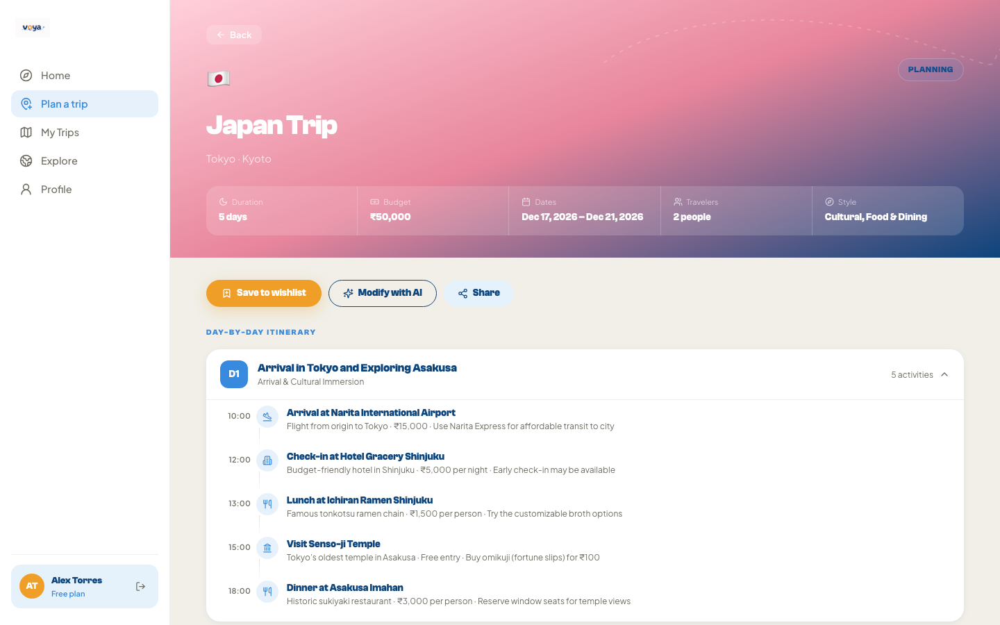
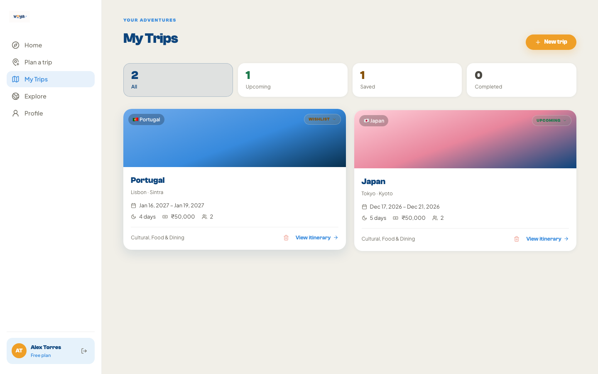

# Voya: AI travel planner

Voya turns a destination, dates and a budget into a day-by-day itinerary with real places and an estimated cost breakdown. You can save trips, track them from wishlist to completed, and ask an AI travel assistant anything.

**Live:** https://voya-travel-website-eta.vercel.app

## Screenshots

| Landing page | Dashboard |
|---|---|
|  |  |
| **AI-generated itinerary** | **My Trips** |
|  |  |

<p align="center"></p>

_The itinerary and dashboard screenshots show real AI output from the live site._

## Features

- **AI itineraries:** day-by-day plans with real hotels, restaurants and landmarks, plus an estimated budget breakdown (flights, stay, food, activities, transport, misc).
- **Personalised:** your home airport, budget tier and travel style from your profile shape every plan.
- **My Trips:** save to wishlist, mark as upcoming ("Book it all") or completed, delete, reopen any itinerary.
- **AI travel assistant:** chat on the dashboard (visas, weather, packing, food…).
- **Accounts:** email + password, or a passwordless sign-in link sent by email. Google sign-in is planned.
- **Profile:** photo upload, plus stats and achievements computed from your real trips.
- Works on desktop and mobile.

## Tech stack

| Layer | Tech |
|---|---|
| Frontend | HTML/CSS + React 18 (CDN) + Babel Standalone (no build step), Lucide icons |
| Backend | Python, Flask 3, PyJWT |
| Data / Auth / Storage | Supabase (Postgres, Auth, Storage) |
| AI | OpenRouter → free NVIDIA Nemotron 3 Ultra, with automatic fallback to a second free model (configurable) |
| Hosting | Vercel (Python Function, Fluid Compute) |

## Architecture

```
Browser ──► Flask on Vercel ──┬──► Supabase (Postgres · Auth · Storage)
            • pages: / /login /app/*      └──► OpenRouter (AI)
            • JSON API: /api/*
```

- One origin serves both the pages and the API, so all frontend calls are relative (`/api/...`).
- After login (any method) the server issues a signed session token (HS256, 7 days). Every user-scoped endpoint takes the user's email **only** from that token.
- The backend uses the Supabase **service-role** key. Tables have RLS enabled with no public policies, so the public key can't read them.

More detail: [`VOYA_STUDY_GUIDE.md`](VOYA_STUDY_GUIDE.md).

## Project layout

```
backend/app.py          Flask app: page routes + /api
frontend/landing/       Landing page          → /
frontend/auth/          Login/signup + OAuth  → /login, /auth/callback
frontend/app/           Signed-in app (JSX)   → /app, /app/plan, /app/trips, /app/explore, /app/profile
frontend/shared/        CSS, logos, voya.js (session + API helper)
supabase/schema.sql     Tables, indexes, RLS, grants, avatars bucket
pyproject.toml          Dependencies + Vercel entrypoint
vercel.json             Flask framework, 120s max duration
```

## Run locally

Requirements: Python 3.12+, a Supabase project, an OpenRouter API key.

```bash
git clone https://github.com/afreenanz/Voya-TravelWebsite.git
cd Voya-TravelWebsite

python3 -m venv .venv
source .venv/bin/activate
pip install -r backend/requirements.txt

cp .env.example .env      # then fill in the values (see below)
python backend/app.py     # → http://localhost:5001
```

> Port 5001 is the default because macOS uses 5000 for AirPlay. Override with `PORT=…`.

### Environment variables

| Variable | Where to get it |
|---|---|
| `SUPABASE_URL` | Supabase → Project Settings → Data API → Project URL |
| `SUPABASE_SERVICE_ROLE_KEY` | Supabase → Project Settings → API Keys → **secret** key (server-side only) |
| `OPENROUTER_API_KEY` | https://openrouter.ai/keys |
| `OPENROUTER_MODEL` | Optional, defaults to `nvidia/nemotron-3-ultra-550b-a55b:free` |
| `OPENROUTER_FALLBACK_MODELS` | Optional, comma-separated backups used when the main model is rate-limited (default `google/gemma-4-31b-it:free`) |
| `GEOAPIFY_API_KEY` | Not used yet; reserved for the upcoming places search (free tier) |
| `APP_SECRET_KEY` | `python3 -c "import secrets; print(secrets.token_urlsafe(48))"` |
| `APP_BASE_URL` | `http://localhost:5001` locally, your production URL on Vercel |

### Database

Run [`supabase/schema.sql`](supabase/schema.sql) in **Supabase → SQL Editor**. It's idempotent and creates the `users`, `trips` and `searches` tables, indexes, RLS, grants and the public `avatars` storage bucket.

### Supabase Auth settings

- **Authentication → URL Configuration:** Site URL = your production URL. Redirect URLs = `<prod>/auth/callback`, `http://localhost:5001/auth/callback`.
- **Email sign-in:** works with Supabase's default Magic Link template. The link opens `/auth/callback`, which completes the login.
- **Google (optional, planned):** enable **Authentication → Providers → Google** with a Google OAuth client ID and secret. The app's `/auth/google` route already supports it.

## Deploy (Vercel)

1. Import the repo in Vercel (or `vercel link`).
2. Add the environment variables above for **Production** and **Preview**. Set `APP_BASE_URL` for Production only, so preview deployments use their own URL.
3. Push to `main` to deploy to production. Other branches get preview URLs.

Notes:
- The Flask app is a single Vercel Function (`pyproject.toml` → `backend.app:app`). `vercel.json` gives it `maxDuration: 120` because itinerary generation takes 15–40s.
- Request bodies are capped at 4.5 MB on Vercel; avatars are limited to 2 MB.
- Rate limits are in-memory per function instance (best-effort).

## License

All rights reserved.
